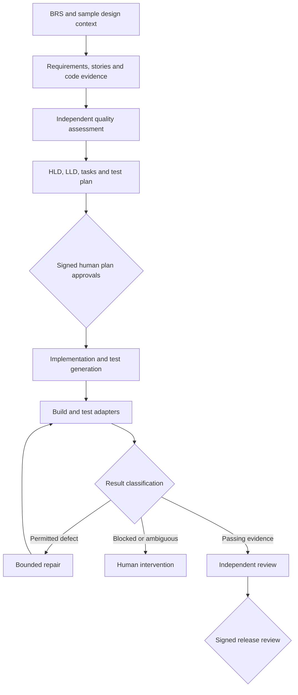

# Harness architecture
Copilot produces engineering artifacts; a deterministic Python CLI validates structure, computes readiness, verifies signed approvals and runs configured adapters. Human operators invoke stages sequentially through the IDE or CLI. The controller never fabricates BRS interpretation or design content.

Design pack: HLD plus application impact, integration, data, security, NFR, decisions, deployment, review and LLD. Supporting sections can state N/A with reasons. Traceability uses structured requirements/stories/tasks/test-cases JSON. Human approval binds inputs, plan, baseline and control files. Release approval additionally binds current source, observed test evidence and independent review.
Trust boundary: authoritative controller and public-key store live outside agent control; private keys remain on reviewer machines. In a local same-user checkout this is a workflow safeguard, not OS isolation. Production must run authoritative validation from a pinned protected revision on an isolated service/runner, restrict repository mutation through branch protections, isolate credentials, and persist run evidence/repair counters outside worker write access. The starter's local counters, reviews and XML are worker-writable; cryptographic human review detects reviewed artifact changes but does not prove test truth or human independence.
No self-merge, production deployment or automatic UrbanCode invocation is included. Hooks and prompts are supplementary instructions, not security boundaries. Revocation/expiry, concurrent locking, durable audit storage, environment attestations and organisation identity/role integration require service deployment work before unattended use.
